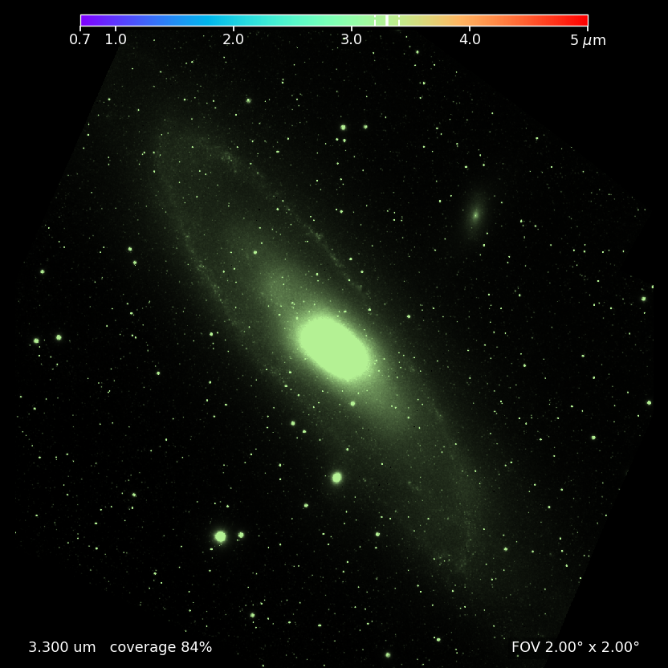
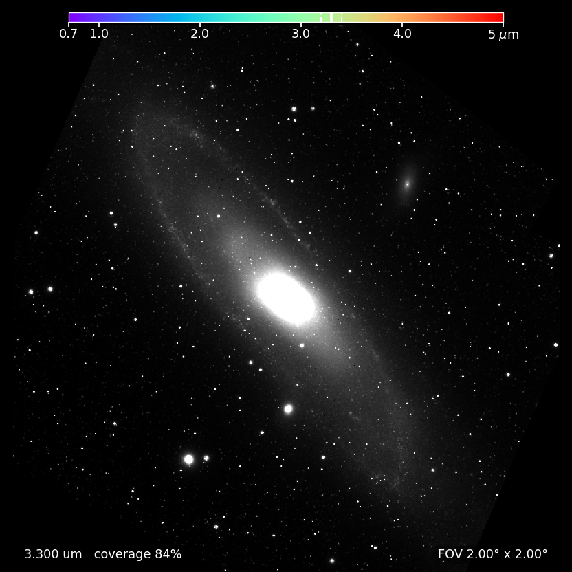
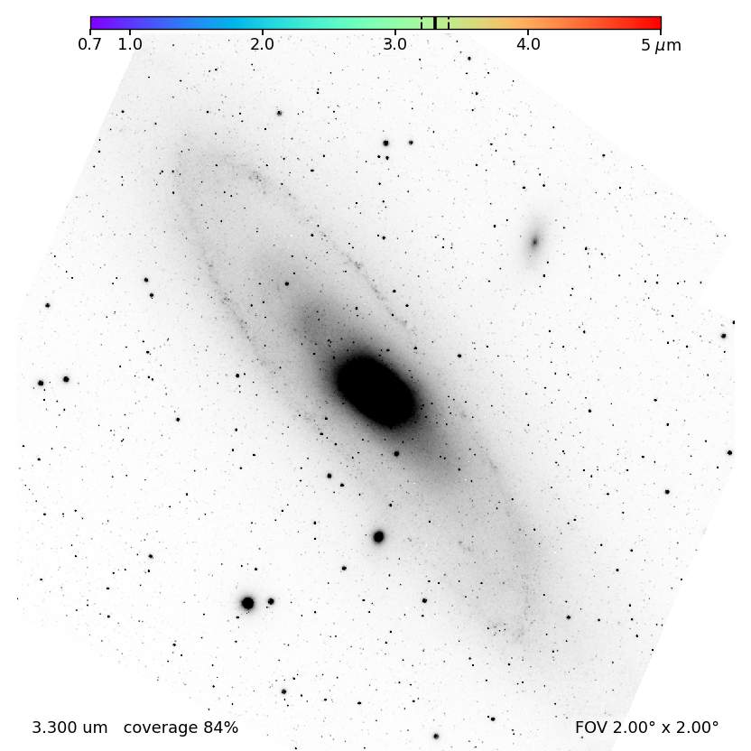
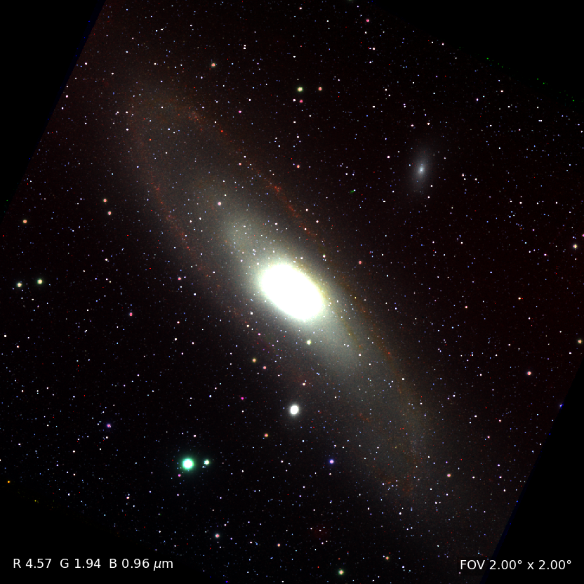
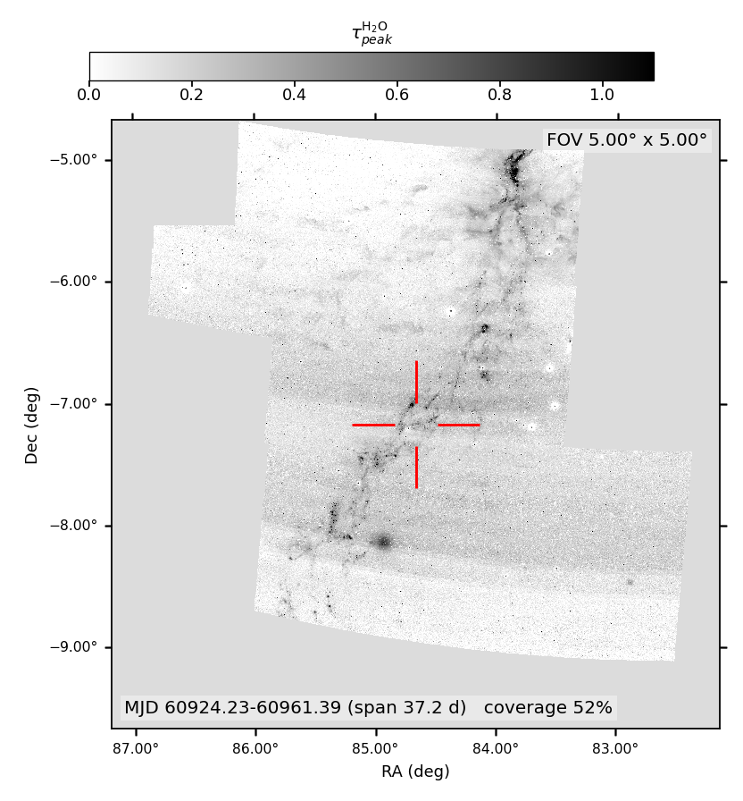
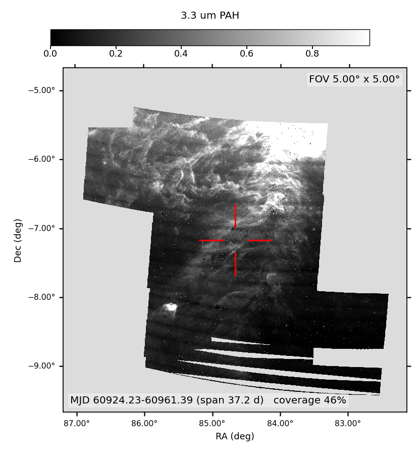

**Point it at any patch of sky and get back a real SPHEREx picture, start to finish, in one
command.**

SPHEREx scans the whole sky from 0.75 to 5 µm, and most of that data is just sitting on
[IRSA](https://irsa.ipac.caltech.edu/), waiting for someone to look at it. This project does
exactly that. Give it coordinates, and it pulls the SPHEREx Level 2 exposures
that cover that spot, cleans them up, and hands you back something you can actually look at, a
monochromatic image, a false-color RGB, a full spectral cube, or a GIF sweeping across
wavelength. No IRSA queries to hand-write, no FITS wrangling, just a target and a command.


*Andromeda (M31), swept across SPHEREx's full 0.75-5 µm range. Each frame is a separate image
built from every exposure whose own wavelength lands within 0.1 µm of that frame's center, so as
the GIF plays you're watching the same galaxy at one narrow wavelength window after another.*

## What do you want to do?

New here? Don't worry about reading the whole page first. Find the case below that matches what
you want, copy the command into a terminal, swap in your own coordinates, and run it. Every
command below is complete and really works, nothing left out.

### A picture at a single wavelength

```bash
spherex-get --ra 10.6847 --dec 41.269 --size_deg 2.0 --mosaic 3.3
```

Writes `m31/mosaic_3.30um.png`, one clean image at 3.3 µm (the PAH dust feature, as an example).
Change `3.3` to any wavelength between 0.75 and 5, in microns.

### The full spectral cube, every wavelength at once

```bash
spherex-get --ra 10.6847 --dec 41.269 --size_deg 2.0 --animate
```

Writes `m31/cube.fits` (the cube itself, one image per wavelength bin) and `m31/slices.gif`, a
movie sweeping through all of them, the same kind of GIF shown above.

### A false-color RGB picture from three wavelengths

```bash
spherex-get --ra 10.6847 --dec 41.269 --size_deg 2.0 --rgb 4.57 1.94 0.96
```

Writes `m31/rgb.png`. The three numbers are the wavelengths, in microns, that become the red,
green, and blue channels.

### A map of water ice, CO2 ice, or PAH emission

```bash
spherex-ice-get --ra_center 86.72955 --dec_center 0.392931 --size_deg 0.5 --feature h2o --out my_field_h2o
```

Writes `my_field_h2o/tau_maps/h2o/tau_median.png`. Swap `--feature h2o` for `co2` or `pah` to map
those instead. This one case has a lot more to it (stacking several epochs, combining features
into one picture, checking a pixel's real spectrum), so once this basic command makes sense, read
[Mapping a named feature](#mapping-a-named-feature-water-ice-co2-ice-pah-emission) below for the
rest.

### The real spectrum behind one specific pixel of a map

```bash
spherex-ice-inspect --tau_dir my_field_h2o/tau_maps --feature h2o --cutouts my_field_h2o/.spherex_ice/cutouts
```

Opens a window with the map on screen. Double-click any spot on it and its real spectrum shows up
in a second window, read from the raw data. More on this in
[Checking a map pixel by pixel](#checking-a-map-pixel-by-pixel) below.

## What it can do

- **Spectral cubes, as GIF or MP4.** Stack monochromatic frames along wavelength and watch a
  field change from 0.7 to 5 µm.
- **Custom RGB images.** Pick any three wavelengths in that range and compose a false-color
  cutout.
- **One clean image at one wavelength**, when that's all you actually need.
- **Grayscale and invert rendering.** `--grayscale` drops the per-wavelength color tint in favor
  of plain black-and-white intensity (the colorbar still tells you where you are in the
  spectrum); the eye tends to pick out faint extended structure more easily this way than in a
  single hue. Add `--invert` on top for the classic photographic-negative look, dark structure on
  a light background, the kind of thing people actually print.
- **Point it at any patch of sky.** Give it RA/Dec coordinates and it'll go find whatever SPHEREx
  has of that spot.
- **One command, start to finish.** `spherex-get` queries IRSA, downloads everything with a live
  progress bar and an ETA, and builds the cube, all in one call.

## How it actually works

1. Query IRSA's TAP service for every SPHEREx Level 2 exposure whose footprint lands inside an
   RA/Dec box (optionally only the ones whose spectral range covers a wavelength you care about).
2. Download a server-side cutout for each one (`/ibe/cutout`), cropped to that same box, instead
   of pulling down the full ~72 MB detector frame.
3. Mask out bad pixels using the `FLAGS` quality HDU (hot pixels, saturation, transients,
   persistence) and paint over them.
4. Look up each pixel's actual wavelength from the `WCS-WAVE` table (SPHEREx's linear variable
   filter means wavelength shifts across the detector, not just from one exposure to the next).
5. Reproject every exposure onto one common sky grid.
6. Match backgrounds between overlapping exposures, so you don't get visible seams where
   different visits had slightly different leftover background or zodiacal light.
7. Bin everything by wavelength and coadd it, streaming one exposure at a time so memory stays
   bounded by the output grid, not by how many exposures you threw at it.
8. Write out FITS (mosaics, cubes), GIF/MP4 (wavelength sweeps), and PNG (single-wavelength
   previews, RGB composites).

So why does any of this work at all? SPHEREx revisits the same patch of sky from different
pointings, so a given sky position lands on a different detector row, and therefore sees a different
wavelength, on each pass. String enough of those dithered visits together and you can reassemble,
pixel by pixel, a spectrum built out of snapshots that each only ever saw one narrow slice of it.
The more exposures cover your field, the fewer gaps you'll see at any given wavelength (see
[Limitations](#limitations) for what that looks like when coverage is thin).

## Installing it

You'll need Python 3.10 or newer.

```bash
git clone https://github.com/javiserna/SPHERExstack.git
cd SPHERExstack
pip install -e ".[animate]"
```

`[animate]` pulls in `matplotlib`, `imageio`, and `pillow`, needed for `spherex-animate`,
`spherex-rgb`, and the PNG previews that `spherex-mosaic`/`spherex-merge`/`spherex-get` write.
If all you need is FITS output, `spherex-query`, `spherex-download`, and `spherex-cube` work
without any of that.

Prefer a venv or conda env instead of your system Python? Same install, just activate first:

```bash
python3 -m venv .venv && source .venv/bin/activate   # or: conda create -n spherexstack python=3.11 && conda activate spherexstack
pip install -e ".[animate]"
```

That gets you eight commands on your `PATH` (`spherex-get`, `spherex-query`,
`spherex-download`, `spherex-mosaic`, `spherex-merge`, `spherex-cube`, `spherex-animate`, and
`spherex-rgb`). `--help` on any of them lists every option.

**Want named features instead of, or alongside, a plain wavelength mosaic** (water/CO2/CO ice,
PAH, the recombination lines)? Install `spherex-ice` on top, from the same clone:

```bash
pip install -e "packages/spherex-ice[dev]"
```

That adds `spherex-ice-get`, `spherex-ice-epochs`, `spherex-ice-map`, `spherex-ice-rgb`,
`spherex-ice-blend`, `spherex-ice-from-cube`, and `spherex-ice-inspect`. More on these in
[Mapping a named feature](#mapping-a-named-feature-water-ice-co2-ice-pah-emission) below, or go
straight to the package's own [README](packages/spherex-ice/README.md).

## Quick start

### Just want one image at one wavelength? Three commands.

The most common ask I get is some version of "I don't need the whole cube, just a clean image at
one wavelength." Take the 3.3 µm PAH feature as an example, a go-to tracer of photo-dissociation
regions and star formation. This is the fastest way there. `--lambda_um` on `spherex-query` tells
IRSA to only hand back exposures whose detector actually covers 3.3 µm (way fewer files than a
full-spectrum query), and `spherex-mosaic` builds the single image directly, no cube involved:

```bash
# 1. Only the exposures that actually cover 3.3 um
spherex-query --ra_center 10.6847 --dec_center 41.269 --size_deg 2.0 \
    --lambda_um 3.3 --dlambda_um 0.1 --out manifest_pah.csv

# 2. Download just those cutouts (live progress bar + ETA)
spherex-download --manifest manifest_pah.csv --roi manifest_pah.roi.json \
    --outdir cutouts_pah --workers 6

# 3. The image itself, plus FITS (MOSAIC + WEIGHT) if you want to keep analyzing it
spherex-mosaic --list list.txt --roi manifest_pah.roi.json \
    --lambda_um 3.3 --dlambda 0.1 --out pah_3p3um.png --out_fits pah_3p3um.fits
```

Swap in your own coordinates for whatever field you care about. If step 3 comes back patchy, widen `--dlambda` a bit (it
needs to be at least as wide as the `--dlambda_um` you used in step 1); a bigger `--size_deg` in
step 1 also helps, since more exposures means better coverage (see
[Limitations](#limitations)).

Or skip straight to one command. `spherex-get --mosaic` does the same thing, and also builds the
full cube alongside it:

```bash
spherex-get --ra 10.6847 --dec 41.269 --size_deg 2.0 --mosaic 3.3
```



Throw `--grayscale` on any of these for plain black-and-white intensity; it's often easier to pick
out faint structure in, like the dust lane here:



And `--invert` on top of that for the classic print look, dark on light:



### The one-command pipeline, for everything else

If you want a cube, or just a picture, for a whole field, `spherex-get` is the one-stop shop. It
queries IRSA, downloads everything (progress bar and ETA included), and builds the spectral cube,
in one call, picking its own file names so you never have to:

```bash
spherex-get --ra 10.6847 --dec 41.269 --size_deg 2.0 --animate --rgb 4.57 1.94 0.96
```

That writes everything under `./m31/`, starting with `cube.fits`, and since `--animate`/`--rgb`
were given, also `slices.gif` and `rgb.png` (toss in `--mosaic 3.3` for a single-wavelength
`mosaic_3.30um.png` too). It prints the `--list`/`--roi` paths it used, so you can reuse them with
any command below without downloading a thing twice. A bigger `--size_deg` fills in more of the
wavelength coverage. See [Limitations](#limitations) for why a small test field often looks
pretty patchy.



Need more control? A rectangular box, custom file names, tiling a big region, tuning
background-matching or weighting, all of that means dropping down to the individual commands:

```bash
spherex-query --ra_center 10.6847 --dec_center 41.269 --size_deg 2.0 --out manifest.csv
spherex-download --manifest manifest.csv --roi manifest.roi.json --outdir cutouts --workers 6
spherex-cube --list list.txt --roi manifest.roi.json --out cube.fits --n_bins 40 --dlambda 0.1
spherex-animate --from_cube cube.fits --out lambda_slices.gif --sec_per_frame 0.4 --min_coverage 0.05
spherex-mosaic --list list.txt --roi manifest.roi.json --lambda_um 3.4 --dlambda 0.3 --out mosaic_3p4um.png
spherex-rgb --list list.txt --roi manifest.roi.json --lambda_r 4.57 --lambda_g 1.94 --lambda_b 0.96 --out rgb.png
```

Or just run the demo script:

```bash
examples/run_small_demo.sh
```

## Mapping a named feature: water ice, CO2 ice, PAH emission

`spherex-mosaic` above maps whatever wavelength you tell it to, which is great when you already
know exactly which band you want. For the common cases of ice absorption and PAH emission,
[`spherex-ice`](packages/spherex-ice/) goes a step further. It already knows each feature's line
and continuum bands, it computes the right quantity for each kind of feature (optical depth for
absorption, flux excess for emission; more on that
[below](#optical-depth-how-ice-absorption-actually-gets-measured)), it stacks multiple epochs
into one sturdier map, and it builds a contour for you. All in one command:

```bash
# Water ice (3.05 um), as an optical depth map
spherex-ice-get --ra_center 86.72955 --dec_center 0.392931 --size_deg 0.5 --feature h2o --out my_field_h2o

# CO2 ice (4.27 um)
spherex-ice-get --ra_center 86.72955 --dec_center 0.392931 --size_deg 0.5 --feature co2 --out my_field_co2

# The 3.3 um PAH emission feature (flux excess, not optical depth; see below)
spherex-ice-get --ra_center 86.72955 --dec_center 0.392931 --size_deg 0.5 --feature pah --out my_field_pah

# All three together, one download, plus a false-color composite (R=H2O, G=CO2, B=PAH)
spherex-ice-get --ra_center 86.72955 --dec_center 0.392931 --size_deg 0.5 \
    --feature h2o co2 pah --auto-rgb --out my_field
```

Here's one epoch of what the first two commands above actually produce, for the Orion Nebula
Cluster, water ice next to PAH emission over the same patch of sky:




Both are the same kind of grayscale map; the PAH one just has the black/white sense flipped so
the two are easy to tell apart side by side.

Each run writes `tau_maps/tau_epochNN.fits`/`.png` per observation epoch, a per-pixel median
across all of them, and a contour mask (see
[Stacking](#stacking-cubes-epochs-and-multi-feature-composites) below). The
[`spherex-ice` README](packages/spherex-ice/README.md#named-features---feature) has the full
table of presets, including CO ice and the five hydrogen recombination lines, plus every other
science case it covers.

## Checking a map pixel by pixel

Sometimes a map isn't enough and you want to see the real spectrum behind one specific pixel.
Both packages give you a way to do that:

- **From a `spherexstack` cube**, `spherex-cube`'s `CUBE` HDU is shaped `(n_bins, ny, nx)`, so
  `CUBE[:, y, x]` is literally that pixel's binned spectrum, matched up against the wavelengths
  in the `COVERAGE` table. Nothing fancy, just a FITS read.
- **From `spherex-ice`'s raw exposures**, which is finer-grained (every individual exposure's own
  flux at its own wavelength, not a binned average). `spherex-ice-inspect` opens an interactive
  viewer over one or more already-built feature maps. Double-click a spot, and it pulls that
  position's real spectrum straight from the cutouts still sitting on disk:

  ```bash
  spherex-ice-inspect --tau_dir my_field/tau_maps --feature h2o pah --cutouts my_field/.spherex_ice/cutouts
  ```

  This is also the easiest way to catch the kind of mix-up described
  [below](#one-thing-to-keep-in-mind-about-every-map-here). A real line shows up as an actual dip
  or bump at the wavelength you expect, among the raw points, not just a jump between the two
  continuum bands. See the
  [`spherex-ice` README](packages/spherex-ice/README.md#checking-a-pixels-real-spectrum-spherex-ice-inspect)
  for the full walkthrough (marking several positions, saving spectra to CSV/PNG, all of it).

## Optical depth: how ice absorption actually gets measured

For an ice absorption line (H2O, CO2, CO), `spherex-ice` reports optical depth, tau:

```
tau = ln(F_continuum / F_line)
```

`F_line` comes from the narrow band centered on the ice line itself; `F_continuum` is the
flux you'd expect there if the ice weren't absorbing anything, interpolated from two bands
straddling the line, one bluer and one redder. `tau = 0` means no absorption worth talking about;
`tau = 1` means the line's down to about 37% of the continuum (1/e); the higher it goes, the more
ice sits along that sightline. It's a ratio, not a flux, so it doesn't care how bright the
background star or cloud happens to be, which is exactly why a ratio, rather than a plain
subtraction, is the right tool for an absorption feature.

It's worth knowing that this is a peak, lower-bound estimate, not a full column density from
radiative transfer. Away from a sightline toward a bright background star, the "continuum" you're
measuring against is itself partly foreground emission, and SPHEREx's own spectral resolution
dilutes the measured depth a little compared to the line's true peak (a small effect for the
broad H2O band specifically; the
[`spherex-ice` caveats](packages/spherex-ice/README.md#caveats-read-before-trusting-a-value)
go into how much). Emission features (PAH, the recombination lines) sit *above* the continuum
instead of below it, so a log ratio doesn't mean anything there. `spherex-ice` just reports the
plain continuum-subtracted excess, `F_line - F_continuum`, in the same MJy/sr units SPHEREx
images already use.

## Customizing bands: measuring your own line, or just the continuum

Every named `--feature` (`h2o`, `co2`, `co`, `pah`, and the five hydrogen lines) is really just
five numbers under the hood, the line center, its half-width, and the two continuum band edges.
None of that is hardcoded into the pipeline itself. `--feature custom` hands you those same five
numbers directly, so you can map any narrow feature SPHEREx's 0.75–5 µm range covers, or nudge a
preset's continuum bands if they don't quite fit your field:

```bash
spherex-ice-map --epochs epochs.json --roi manifest.roi.json --epoch all --feature custom \
    --lam_line 2.121 --dlambda_line 0.03 \
    --cont_blue_lo 2.00 --cont_blue_hi 2.08 \
    --cont_red_lo 2.20 --cont_red_hi 2.28 \
    --out_dir tau_maps_h2_2um
```

(That's H2 at 2.12 µm, just as an example of a line with no built-in preset. Check the result and
adjust the continuum bands to taste. See the
[`--feature custom` notes](packages/spherex-ice/README.md#named-features---feature) and
[the caveat below](#one-thing-to-keep-in-mind-about-every-map-here) on why picking bands clear of
*other* known lines actually matters.) `--kind absorption` or `--kind emission` picks which
formula above applies (defaults to absorption). And if all you want is the continuum band's own
image, with no line/continuum comparison at all, `spherex-mosaic --lambda_um/--dlambda` does that
directly.

## Stacking: cubes, epochs, and multi-feature composites

"Stacking" covers a few different things here, and they all build on the same coaddition code
under the hood.

Stacking exposures into one wavelength bin is the basic move `spherex-mosaic`/`spherex-cube` make
by default. Every exposure whose pixel-level wavelength lands within `±dlambda` of a bin center
gets averaged (or inverse-variance-weighted with `--weighting ivar`) onto the output grid.
Everything else is built on top of that one step.

Stack enough of those bins and you get a cube. `spherex-cube --n_bins 40` repeats the step above
across however many bins you ask for, writing out a real spectral-WCS FITS cube that
`spherex-animate` can then sweep through as a GIF or MP4.

Stack observation epochs and you get `spherex-ice-map`'s per-pixel median across them
(`tau_median.fits`, built automatically whenever there's more than one epoch; see
[Median across epochs](packages/spherex-ice/README.md#median-across-epochs)). This isn't just a
nicer-looking average. A single bad epoch (one outlier exposure, a registration mismatch) only
drags the median off if it affects more than half the epochs at that pixel. Add `--cube` and
you'll also get a compact, re-processable summary of each epoch (31x smaller than the raw cutouts
in one real case I measured), so you can go back and rebuild the median later, or try a different
`--contour_level`, without re-downloading anything (`spherex-ice-from-cube`).

And stack features into one picture with `spherex-ice-rgb` (literal red/green/blue channels, like
the H2O/CO2/PAH example [above](#mapping-a-named-feature-water-ice-co2-ice-pah-emission)) or
`spherex-ice-blend` (screen-blends 2-3 maps while keeping each one's own color, H2O's blue ice
scale over PAH's red-hot one, say). See
[RGB composites](packages/spherex-ice/README.md#rgb-composites-up-to-three-maps-in-one-picture)
and [per-feature colormaps](packages/spherex-ice/README.md#per-feature-colormaps-and-blending-them-spherex-ice-blend)
for both.

## One thing to keep in mind about every map here

A map here, a single-wavelength `spherex-mosaic` image just as much as a named `spherex-ice`
feature map, only compares flux across a handful of fixed, narrow wavelength windows. It isn't
fitting a line, it isn't identifying anything; it's just measuring how much light lands inside
the window(s) you pointed it at. So what you get out is really "there's more or less signal here
than elsewhere," not "this pixel definitely contains the feature I asked for." If some unrelated
line happens to fall inside the same narrow window, the map has no way of telling the difference.

This isn't a corner case I'm inventing to cover myself. One of the named presets runs right into
it, Br-beta's line sits inside H2O's own blue continuum band (see
[the `spherex-ice` caveats](packages/spherex-ice/README.md#the-one-thing-every-map-here-can-get-fooled-by)
for the measured effect), so a strong Br-beta source can quietly push an H2O map's reading in the
wrong direction. The same thing can happen with `--feature custom`'s hand-picked bands, or a plain
`spherex-mosaic --lambda_um` near a line you didn't account for. Nothing stops it. Treat any map
here as "where this signal looks stronger or weaker," and before you report a pixel as a detection
of something specific, pull up its real spectrum with `spherex-ice-inspect` (see
[Checking a map pixel by pixel](#checking-a-map-pixel-by-pixel) above) and make sure what you're
seeing actually looks like the line you think it is.

## Outputs

Every header/column name below comes straight from the FITS files this package actually writes.
Flux values in `MOSAIC` and `CUBE` are SPHEREx's native MJy/sr surface brightness by default,
recorded in each HDU's own `BUNIT`. Pass `--units mjy` to `spherex-mosaic`/`spherex-cube` to get
a per-pixel flux density in mJy instead, the same conversion [IRSA's own SPHEREx mosaic-cube
tutorial](https://caltech-ipac.github.io/irsa-tutorials/spherex-mosaic/) uses before doing
aperture photometry on it.

| Command | File(s) | Contents |
|---|---|---|
| `spherex-get` | `<out>/manifest.csv`, `<out>/roi.json`, `<out>/cutouts/*.fits`, `<out>/list.txt` | Same as the `spherex-query`/`spherex-download` rows below, just with fixed names inside `<out>` |
| | `<out>/cube.fits` | Same structure as `spherex-cube`'s output, below |
| | `<out>/slices.gif`, `<out>/rgb.png` | Only with `--animate`/`--rgb`; same structure as `spherex-animate`'s and `spherex-rgb`'s output |
| | `<out>/mosaic_<lambda>um.png` | Only with `--mosaic LAMBDA_UM`; same structure as `spherex-mosaic`'s PNG |
| `spherex-query` | `manifest.csv` | Columns `obs_id, s_ra, s_dec, energy_bandpassname, t_min, uri, contentlength`, one row per matching exposure |
| | `<out>.roi.json` | `ra_min, ra_max, dec_min, dec_max, ra_center, dec_center, width_deg, height_deg` |
| `spherex-download` | `<outdir>/*.fits` | Cutout FITS, HDUs `PRIMARY, IMAGE, FLAGS, WCS-WAVE` by default (add `VARIANCE` via `--keep-hdus` for `--weighting ivar`) |
| | `list.txt` | One cutout path per line, the input `spherex-mosaic`/`spherex-cube`/`spherex-animate`/`spherex-rgb` expect |
| `spherex-mosaic` | `<out>.png` | Single-wavelength preview, wavelength colorbar up top, field-of-view label bottom-right |
| | `<out_fits>` | `PRIMARY` (empty), `MOSAIC` (float32, 2D WCS, `LAMBDA_UM`/`DLAMBDA_UM` keys), `WEIGHT` (float32, total weight per pixel; an exposure count under `--weighting mean`) |
| `spherex-merge` | `<out>` | Same `MOSAIC`/`WEIGHT` structure as `spherex-mosaic`, plus `NTILES` |
| | `<out_png>` | Optional preview |
| `spherex-cube` | `<out>` | `PRIMARY` (empty), `CUBE` (float32, `(n_bins, ny, nx)`, 3D WCS with `CTYPE3 = WAVE` in meters, per the FITS standard, even though `--dlambda` is in microns), `WEIGHT` (same shape), `COVERAGE` (one row per bin: `LAMBDA_UM`, `COVERAGE_FRAC`) |
| `spherex-animate` | `<out>.gif`/`.mp4` | One frame per wavelength bin (or per raw exposure in `--mode raw`) |
| | `_frames_*/*.png` | The individual frames, next to the input list or cube |
| `spherex-rgb` | `<out>.png` | Three single-wavelength mosaics stretched independently and composed as R/G/B; wavelengths and FOV labeled bottom-left/right |

## Limitations

A few things worth knowing before you lean on a result too hard:

Coverage at any one wavelength depends entirely on how many exposures happen to cover your
field. A small `--size_deg` means few dithers, which means big gaps (`NaN`) in most bins. A 0.7°
field can have as few as ~8 exposures where a 2.0° field has well over 100. Nothing fills those
gaps in; per-bin coverage always gets printed, and it's in the `COVERAGE` table too, so you can
judge how much to trust a given slice.

Coaddition is an unweighted mean by default. `--weighting ivar` weights by `1/VARIANCE` instead
(falling back to `mean` for any exposure without a usable `VARIANCE` HDU; re-download with
`--keep-hdus` including it if you want to use this). The zodiacal light model (`ZODI`) is never
subtracted either; only the *relative* offsets between overlapping exposures get matched, to kill
seams, never an absolute background level.

Wavelength binning works off each pixel's own central wavelength within `--dlambda`; the full
shape of SPHEREx's spectral response isn't modeled, so the effective bandpass drifts slightly
pixel to pixel within a bin. And the wavelength range used to pick bin centers can actually be
wider than what a cropped ROI cutout contains. The `WCS-WAVE` table can retain the full detector's
span even after `IMAGE`/`FLAGS` get cropped by `/ibe/cutout`, so a bin near the edge of that range
can end up empty even though the file's metadata technically claims coverage there. You'll see a
warning when that happens; `spherex-animate --min_coverage` skips the resulting blank frames.

No PSF homogenization happens across wavelength; each slice is coadded as-is. Background matching
in the default streaming mode is sequential, each new exposure compared only against what's
accumulated so far, not a full joint solve (the heavier, memory-hungry point-target legacy mode
does that, but it also doesn't support `--weighting ivar`, and it's really meant for quick
single-target looks, not the main large-ROI path). `spherex-animate --mode raw` is its own thing
too, a per-exposure, no-coaddition visualization, not a separate command.

`spherex-get` is a convenience wrapper, not its own implementation. It
always builds a square ROI, so for a rectangle, a tiled region, or cutouts you already have laid
out differently, go straight to `spherex-query`/`spherex-download`/`spherex-cube` (it prints the
`--list`/`--roi` paths it wrote, so dropping down afterward is easy). Its default of 1 download
worker is intentionally conservative for a first run; bump `--workers` once you trust it.
`spherex-download` itself still defaults to 6.

One last thing. This was built and tested against SPHEREx Quick Release 3 (QR3) and Data
Release 1 (DR1) Level 2 data, so a later release could change the file format underneath it.

## Performance, time, and disk space (read before a large field)

The download step shows a live progress bar with an ETA, since it's the one step whose timing is
genuinely hard to predict. It scales with how many exposures cover your field, which grows
quickly with `--size_deg`, and faster still once you cross SPHEREx's native detector FOV (~3.47°,
more on that below). Memory for `spherex-cube`/`spherex-mosaic` scales with `n_bins x grid_size`,
not with the number of exposures, since each one gets loaded, reprojected onto just the part of
the grid it overlaps, accumulated, and dropped. For a region too big to hold in memory at once (or to avoid
losing everything if a run fails halfway through), build partial mosaics per sub-region with
`spherex-mosaic --out_fits`, delete that sub-region's raw cutouts, and combine the partials
afterward with `spherex-merge`.

### Roughly what to expect at 1° vs. 5° on a side

Take these as ballpark numbers, not a promise. The real figure for your field depends on how
densely SPHEREx happens to have surveyed that patch of sky so far (it's still an early, ongoing
survey), your connection, and `--workers`. Both `spherex-query`/`spherex-get` and
`spherex-ice-get` print the actual exposure count and grid size for your specific field before
downloading anything, and that's the number worth planning around, not the table below. If you're
not sure, run a small `--size_deg` test first.

| Field (square) | Relative to native FOV (~3.47°) | Exposures | Raw download | Processing |
|---|---|---|---|---|
| 1° x 1° | well inside it: cutouts still get cropped down | tens up to ~150 (0.7° had ~8, 2.0° had 100+ in a real test) | tens of MB up to roughly 1 GB | seconds to a couple minutes per band/bin, on an ordinary machine |
| 5° x 5° | past it: cutouts stop getting cropped, so most exposures come back near their full ~72 MB, and a bigger area pulls in a lot more exposures to begin with | plausibly several hundred+ | tens of GB | background matching scales roughly with the *square* of exposure count per band, so this can run tens of minutes to a few hours |

The jump between those two rows isn't gradual. It's that ~3.47° cutoff doing most of the damage,
not area by itself. If you only need one feature or wavelength, filter the query first
(`--lambda_um`, or any `--feature`); that alone usually cuts the download down a lot more than
shrinking `--size_deg` would.

### Disk fills up faster than you'd think on a large field

It's the raw cutouts that eat disk, not the final products. Tens of GB is realistic once you're
near or past that native-FOV line, and it's easy to not notice until `df` tells you. A few ways to
keep it in check, roughly most-to-least effective:

- Query only the wavelength or feature you actually need. That alone often cuts the file count
  5-10x before anything else kicks in.
- `spherex-ice --cube --delete-cutouts-after-cube`. Once each epoch's compact cube is written and
  verified to load back correctly, the raw cutouts get deleted automatically. In one real field
  this took 381 files (59 MB) down to 3 cubes (1.9 MB), about 31x smaller. The small
  manifest/roi/epochs.json stick around in case you want to re-download later.
- Tile and merge. Build partial mosaics with `spherex-mosaic --out_fits`, delete that tile's
  cutouts, combine afterward with `spherex-merge`, so only one tile's worth of cutouts ever sits
  on disk at once.
- `--keep-hdus` (the default) already drops `PSF`/`ZODI` from every download, about 60% smaller
  with no real loss here. Add `VARIANCE` back only if you actually need `--weighting ivar`.

### A flaky download doesn't need you to babysit it

A single file can fail to download for all sorts of boring reasons, a timeout, a dropped
connection, IRSA just being slow. And that gets more likely the more files a field pulls in.
`spherex-download` (which `spherex-get` and `spherex-ice-get` both use) already retries each file
up to 3 times with backoff within one pass. On top of that, once the main pass finishes, it
automatically runs up to 2 more passes (`--retry-passes`, default 2) over whatever's still
missing, telling you which files and why each time. You shouldn't need to notice a partial
failure and re-run anything by hand. Most of these clear up on their own within a retry or two.
If a few files are still stubborn after all the retries, it prints their names and just carries on
with whatever did download, instead of blowing up the whole run. You'll end up with slightly
lower coverage in the `COVERAGE` table, not a crash. And if you do want another shot at it later,
re-running the exact same `spherex-download` command only touches the files still missing;
anything already on disk gets skipped, same as always.

## Still growing

This is an active project, not a finished one. New SPHEREx data releases, new science cases, and
bugs people actually run into will keep shaping it. If you find something broken, have a feature
you'd like to see, or just want to contribute code, open an issue or a pull request on
[GitHub](https://github.com/javiserna/SPHERExstack). Community input is genuinely welcome, and it's
part of how this is meant to keep improving.

## Data acknowledgment

If you use SPHEREx/IRSA data, IRSA asks that you include this acknowledgment in anything you
publish or derive from this package's outputs:

"This publication makes use of data products from the Spectro-Photometer for the History of the
Universe, Epoch of Reionization and Ices Explorer (SPHEREx), which is a joint project of the Jet
Propulsion Laboratory and the California Institute of Technology, and is funded by the National
Aeronautics and Space Administration."

## Citation

10.5281/zenodo.24388875

## License and contact

MIT License. See [`LICENSE`](LICENSE). Maintained by Javier Serna (University of Oklahoma), 2026.
