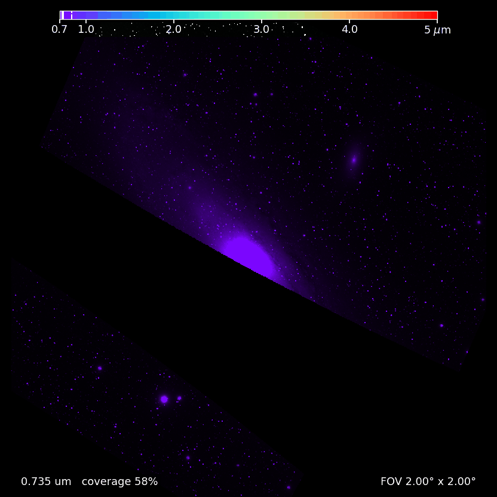

# SPHERExstack

**Stack, slice, and animate any field of the SPHEREx sky survey.**

`SPHERExstack` is a tool to process and visualize any region of the sky across the 0.7–5 µm
wavelength range retrieved from [SPHEREx](https://spherex.caltech.edu/) Level 2 spectral images
on [IRSA](https://irsa.ipac.caltech.edu/) — turning raw observations into monochromatic spectral
cubes, custom false-color RGB images, and shareable animations. It is meant for exploration,
visualization, and quick-look science of extended emission and absorption — not as a replacement
for the official SPHEREx data products.



## Features

- **Spectral image cubes (GIF / MP4):** stack monochromatic frames along wavelength to animate
  how any sky field looks from 0.7 to 5 µm.
- **Custom RGB images:** choose any three wavelengths within 0.7–5 µm to compose tailored
  false-color RGB cutouts.
- **Single-wavelength frames:** generate a clean monochromatic image at any specific wavelength
  of interest.
- **Any sky field:** point to a target's coordinates, or just its name, and visualize any region
  SPHEREx has covered.
- **One-command pipeline:** `spherex-get` resolves a target, queries IRSA, downloads the data, and
  builds the cube in a single call — with a live progress bar and an ETA for the download, since
  that step's wall-clock time depends a lot on how big a field you ask for.

## How it works

1. **Query** IRSA's TAP/ADQL service for every SPHEREx Level 2 science exposure whose footprint falls in an RA/Dec box (optionally filtered to only exposures whose spectral range covers a target wavelength).
2. **Download** a server-side cutout (`/ibe/cutout`) for each exposure, cropped to the same box, instead of the full ~72 MB detector frame.
3. **Mask** bad pixels using the `FLAGS` quality HDU (hot pixels, saturation, transients, persistence, ...) and in-paint them.
4. Look up each pixel's **wavelength** from the `WCS-WAVE` table via the alternate WCS key `'W'` (FITS Paper III "WAVE-TAB"), since SPHEREx's linear variable filter means wavelength varies across the detector, not just by exposure.
5. **Reproject** every exposure onto a common TAN sky grid.
6. **Match backgrounds** between overlapping exposures: an additive per-exposure offset is solved so that regions covered by different exposures don't show visible seams from slightly different residual background/zodiacal subtraction.
7. **Bin by wavelength and coadd** in streaming mode (one exposure at a time, memory bounded by the output grid, not by the number of exposures).
8. Write the result as **FITS** (mosaics, cubes), **GIF/MP4** (wavelength sweeps), **PNG** (single-wavelength previews and RGB composites).

**Why this works at all:** SPHEREx revisits the same patch of sky with different pointings (dithers). Its linear variable filter (LVF) means a given detector row (and therefore wavelength) sees a different part of the sky on each visit. Combining many dithered visits lets you reassemble, for a fixed sky position, a spectrum sampled from pixels that individually only ever saw one narrow wavelength slice, in effect building a spectral cube out of many single-wavelength-per-pixel snapshots. The more exposures cover your field, the fewer gaps you'll see in each wavelength bin, see [Limitations](#limitations).

## Installation

Requires Python ≥ 3.10.

```bash
git clone https://github.com/javiserna/SPHERExstack.git
cd SPHERExstack
pip install -e ".[animate]"
```

(`[animate]` pulls in `matplotlib`, `imageio` and `pillow`, needed for `spherex-animate`,
`spherex-rgb`, and the PNG previews written by `spherex-mosaic`/`spherex-merge`/`spherex-get`.
`spherex-query`, `spherex-download` and `spherex-cube` work without them, if you only need the
FITS products.)

With conda/venv instead of installing straight into your system Python:

```bash
python3 -m venv .venv && source .venv/bin/activate   # or: conda create -n spherexstack python=3.11 && conda activate spherexstack
pip install -e ".[animate]"
```

This installs eight commands onto your `PATH`: `spherex-get`, `spherex-query`,
`spherex-download`, `spherex-mosaic`, `spherex-merge`, `spherex-cube`, `spherex-animate`, and
`spherex-rgb`. Run any of them with `--help` to see every option.

## Quick start

### Just want one image at one wavelength? Map a PAH feature in three commands

A very common ask: "I don't need the whole cube, I just want a clean image at one specific
wavelength" — for example the 3.3 µm PAH (polycyclic aromatic hydrocarbon) emission feature, a
classic tracer of photo-dissociation regions and star-forming environments. This is the fastest,
lightest path to that one image: `--lambda_um` on `spherex-query` means IRSA only returns
exposures whose detector actually covers 3.3 µm (far fewer files to download than a full-spectrum
query), and `spherex-mosaic` builds a single monochromatic image directly, with no spectral cube
built at all:

```bash
# 1. Only the exposures that actually cover 3.3 um -- a small fraction of the full-field query
spherex-query --ra_center 10.6847 --dec_center 41.269 --size_deg 2.0 \
    --lambda_um 3.3 --dlambda_um 0.1 --out manifest_pah.csv

# 2. Download just those cutouts (live progress bar + ETA)
spherex-download --manifest manifest_pah.csv --roi manifest_pah.roi.json \
    --outdir cutouts_pah --workers 6

# 3. The 3.3 um image itself, plus its FITS (MOSAIC + WEIGHT) for further analysis
spherex-mosaic --list list.txt --roi manifest_pah.roi.json \
    --lambda_um 3.3 --dlambda 0.1 --out pah_3p3um.png --out_fits pah_3p3um.fits
```

Swap `--ra_center`/`--dec_center` for your own target's coordinates (if you only have a name, the
`spherex-get --target` shortcut below resolves it via SIMBAD for you). If step 3 comes back with
low coverage, widen `--dlambda` (it must be ≥ the `--dlambda_um` used in step 1); a bigger
`--size_deg` in step 1 also means more exposures and better coverage — see
[Limitations](#limitations).

**Prefer one single command?** `spherex-get` has a `--mosaic` shortcut that does the same thing
(plus it also builds the full cube alongside it, and can resolve the target by name):

```bash
spherex-get --target "M31" --size_deg 2.0 --mosaic 3.3
```


### The general one-command pipeline

**If you want a cube (or a picture) for a field, `spherex-get` is the one-stop command.** It
resolves a target (by name, via SIMBAD, or by RA/Dec) plus a field size, queries IRSA, downloads
the cutouts (with a live progress bar and ETA), and builds the spectral cube — all in one
command. It picks its own manifest/cutout/cube file names inside an output directory, so you
never have to:

```bash
spherex-get --target "M31" --size_deg 2.0 --animate --rgb 4.57 1.94 0.96
# or, if you already have coordinates (also works if SIMBAD is unreachable):
spherex-get --ra 10.6847 --dec 41.269 --size_deg 2.0 --animate --rgb 4.57 1.94 0.96
```

This writes everything under `./m31/` (a directory named after the target): `cube.fits`, and
since `--animate`/`--rgb` were given, also `slices.gif` and `rgb.png` (add `--mosaic 3.3` for a
single-wavelength `mosaic_3.30um.png` too, as above). It prints the `--list`/`--roi` paths it used
at the end, so you can point any of the commands below at the same files without downloading
anything twice. A bigger `--size_deg` means more exposures covering your field, which fills in the
wavelength coverage -- see [Limitations](#limitations) for why a small test field can come out
with a lot of gaps.


**For full control over every step** — rectangular (non-square) boxes, custom file names, tiling
a region too large for one run, tuning background matching/cleaning/weighting per step, or
working from cutouts you already have — use the individual commands:

```bash
spherex-query --ra_center 10.6847 --dec_center 41.269 --size_deg 2.0 --out manifest.csv
spherex-download --manifest manifest.csv --roi manifest.roi.json --outdir cutouts --workers 6
spherex-cube --list list.txt --roi manifest.roi.json --out cube.fits --n_bins 40 --dlambda 0.1
spherex-animate --from_cube cube.fits --out lambda_slices.gif --sec_per_frame 0.4 --min_coverage 0.05
spherex-mosaic --list list.txt --roi manifest.roi.json --lambda_um 3.4 --dlambda 0.3 --out mosaic_3p4um.png
spherex-rgb --list list.txt --roi manifest.roi.json --lambda_r 4.57 --lambda_g 1.94 --lambda_b 0.96 --out rgb.png
```

Or run a small end-to-end example with one script:

```bash
examples/run_small_demo.sh
```

## Outputs

All header/column names below are taken from the actual FITS files this package writes, not assumed.

| Command | File(s) | Contents |
|---|---|---|
| `spherex-get` | `<out>/manifest.csv`, `<out>/roi.json`, `<out>/cutouts/*.fits`, `<out>/list.txt` | Same as the `spherex-query`/`spherex-download` rows below, just with fixed names chosen for you inside `<out>` |
| | `<out>/cube.fits` | Same structure as `spherex-cube`'s output, below |
| | `<out>/slices.gif`, `<out>/rgb.png` | Only with `--animate`/`--rgb`; same structure as `spherex-animate`'s and `spherex-rgb`'s output, below |
| | `<out>/mosaic_<lambda>um.png` | Only with `--mosaic LAMBDA_UM`; same structure as `spherex-mosaic`'s PNG output, below |
| `spherex-query` | `manifest.csv` | Columns `obs_id, s_ra, s_dec, energy_bandpassname, t_min, uri, contentlength` (one row per matching exposure) |
| | `<out>.roi.json` | `ra_min, ra_max, dec_min, dec_max, ra_center, dec_center, width_deg, height_deg` |
| `spherex-download` | `<outdir>/*.fits` | Cutout FITS, HDUs `PRIMARY, IMAGE, FLAGS, WCS-WAVE` by default (add `VARIANCE` via `--keep-hdus` for `--weighting ivar`) |
| | `list.txt` | One cutout path per line (input to `spherex-mosaic`/`spherex-cube`/`spherex-animate`/`spherex-rgb`) |
| `spherex-mosaic` | `<out>.png` | Single-wavelength preview, wavelength colorbar (with units and a moving marker) at top, field-of-view label bottom-right |
| | `<out_fits>` | `PRIMARY` (empty), `MOSAIC` (float32 image, 2D WCS, `LAMBDA_UM`/`DLAMBDA_UM` header keys), `WEIGHT` (float32, total weight per pixel — an exposure count under `--weighting mean`) |
| `spherex-merge` | `<out>` | Same `MOSAIC`/`WEIGHT` structure as `spherex-mosaic`, plus `NTILES` |
| | `<out_png>` | Optional preview |
| `spherex-cube` | `<out>` | `PRIMARY` (empty), `CUBE` (float32, shape `(n_bins, ny, nx)`, 3D WCS — `CTYPE1/2 = RA---TAN/DEC--TAN`, `CTYPE3 = WAVE` with `CRVAL3/CDELT3/CUNIT3` in **meters**, per the FITS WCS standard, even though `--dlambda` etc. are in microns), `WEIGHT` (float32, same shape), `COVERAGE` (binary table, one row per bin: `LAMBDA_UM`, `COVERAGE_FRAC`) |
| `spherex-animate` | `<out>.gif`/`.mp4` | Wavelength sweep, one frame per bin (or per raw exposure in `--mode raw`) |
| | `_frames_*/*.png` | The individual PNG frames, next to the input list or cube |
| `spherex-rgb` | `<out>.png` | Three single-wavelength mosaics composed as (R, G, B), each stretched independently (different wavelengths can have very different flux scales); wavelengths and field of view labeled bottom-left/bottom-right |

## Limitations

These are derived from the code, not assumed:

- **Spatial coverage at a fixed wavelength depends on how many exposures cover your field.** A
  small `--size_deg` means few dithers, which means most wavelength bins will have large gaps
  (`NaN`); a field as small as 0.7° on a side can have as few as ~8 exposures, while the same
  field at 2.0° can have well over 100. Gaps are not filled in; per-bin coverage is always printed
  and written to the `COVERAGE` table, so you can judge how much to trust a given slice.
- **Coaddition is an unweighted mean by default.** `--weighting ivar` weights each pixel by `1/VARIANCE` (falling back to `mean` for any exposure without a usable `VARIANCE` HDU — re-download with `--keep-hdus` including `VARIANCE` to use it).
- **The zodiacal light model (`ZODI` HDU) is not subtracted.** Only *relative* additive offsets between overlapping exposures are matched (to remove visible seams); absolute background levels are never calibrated against a zodiacal/background model.
- **Wavelength binning uses each pixel's own central wavelength within a tolerance (`--dlambda`)**; the full spectral response function of SPHEREx's linear variable filter is not modeled, so the effective bandpass differs slightly from pixel to pixel within the same nominal bin.
- **The wavelength range scanned to pick bin centers can be wider than what a cropped ROI cutout actually contains.** `spherex-cube`/`spherex-animate`/`spherex-get` (in ROI mode) set the bin centers from each file's `WCS-WAVE` lookup table range; that table can retain the full detector's wavelength span even after the `IMAGE`/`FLAGS` arrays are cropped to a small ROI by `/ibe/cutout`, so some bins near the edges of the scanned range may end up with zero coverage even though the exposure's metadata-level spectral range technically includes them. A warning is printed when this happens; `spherex-animate --min_coverage` skips the resulting empty frames.
- **No PSF homogenization across wavelength.** Each wavelength slice is coadded as-is; no attempt is made to match or degrade PSFs between detectors/bands.
- **Background matching in streaming (ROI) mode is sequential/incremental, not a global joint solve.** Each new exposure is compared only against the average accumulated so far in the overlap region; this is not identical to the joint least-squares solve used in the (memory-heavier) point-target legacy mode, though it removes the same kind of seam.
- **Point-target legacy mode (`--target` on `spherex-cube`/`spherex-animate`) does not support `--weighting ivar`**; it falls back to `mean` with a warning. It is meant for quick single-target looks on a small cutout, not the primary large-ROI pipeline.
- **`spherex-animate --mode raw`** reproduces a per-exposure, row-colored (no coaddition) visualization as a separate mode rather than a separate command; it does not bin or coadd across exposures at all.
- **`--target` name resolution depends on SIMBAD being reachable.** `spherex-get --target` queries SIMBAD's own TAP service live; if SIMBAD is down or the name isn't recognized, use `--ra`/`--dec` instead, which never depends on any third-party service beyond IRSA itself.
- **`spherex-get` is a convenience wrapper, not a separate implementation.** It always builds a square ROI (center + `--size_deg`); for a rectangular box, tiling a large region, or reusing cutouts you already downloaded under a different layout, use `spherex-query`/`spherex-download`/`spherex-cube` directly — `spherex-get` prints the `--list`/`--roi` paths it wrote so you can still drop down to those commands afterward.
- **`spherex-get`'s default of 1 download worker is deliberately conservative** (so a first run behaves predictably); raise `--workers` (e.g. `--workers 6`) once you're comfortable with the pipeline. `spherex-download` itself still defaults to 6.
- **Tested against SPHEREx Quick Release 2 (QR2) Level 2 data.** Later data releases may change file formats.
- **Not a substitute for the official SPHEREx data products or SPHEREx Science Team maps.** This is an exploration/visualization tool built from individual Level 2 exposures, not a validated science pipeline.

## Performance notes

- The download step (`spherex-download`, or `spherex-get`'s own download phase) shows a live
  progress bar with throughput and an estimated time remaining, since this is the step whose
  wall-clock time varies the most — it scales with how many exposures cover your field, which
  grows quickly with `--size_deg`.
- Memory for `spherex-cube`/`spherex-mosaic` scales with `n_bins x grid_size`, **not** with the number of exposures: each exposure is loaded, reprojected onto only the sub-window of the output grid it overlaps, accumulated, and discarded.
- For regions too large to fit in memory at once (or to avoid re-downloading everything if something fails partway through), build partial mosaics per sub-region with `spherex-mosaic --out_fits`, delete that sub-region's raw cutouts, and combine the partials afterward with `spherex-merge`.
- `spherex-download` is resumable (files that already exist with nonzero size are skipped) and parallelized (`--workers`).

## Data acknowledgment

Users of SPHEREx/IRSA data are expected to include IRSA's required acknowledgment of the SPHEREx mission and IRSA in any publication or product derived from this package's outputs.

"This publication makes use of data products from the Spectro-Photometer for the History of the Universe, Epoch of Reionization and Ices Explorer (SPHEREx), which is a joint project of the Jet Propulsion Laboratory and the California Institute of Technology, and is funded by the National Aeronautics and Space Administration."

## Citation

10.5281/zenodo.24388875


## License and contact

MIT License — see [`LICENSE`](LICENSE). Maintained by Javier Serna (University of Oklahoma) 2026.
